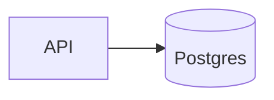
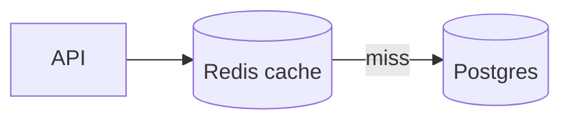

# Generate PR Description

Generate a **concise** PR description based on git changes.

## Steps

- If a PR id is provided, use `gh pr view <PR_ID> --json title,body,baseRefName` and `gh pr diff <PR_ID>`; otherwise use `git diff main...HEAD`.

1. Review the commits and code changes in the branch.
2. Understand the purpose: what problem is solved, what changed, and any breaking changes.
3. Check the diff against the visual triggers below.
4. Generate a description using the template below.

## Visual triggers

| When the diff | Add |
|---|---|
| adds, removes, or reorders a hop in a request, data, or job path (queue, worker, cache, service, middleware); adds or removes states or transitions of a status that is stored or sent to another component (job, payment, subscription); or rewires which module calls which | `## Before / After` diagrams |
| changes what a user sees: markup, templates, components, styles, or UI copy | `## Screenshots` |

### Before / After diagrams

Two Mermaid blocks, one per side:

- Draw only the path the PR changes, at most 10 nodes per diagram.
- Use the same diagram type, node IDs, and labels for the unchanged parts, so the difference shows by comparison.
- `flowchart LR` for components and data flow, `sequenceDiagram` when ordering or sync vs async is the point, `stateDiagram-v2` for lifecycles.
- Quote flowchart labels (`W["Worker (retries)"]`). GitHub refuses to render a diagram with unquoted parentheses or punctuation in a label.
- When the PR creates a flow that did not exist, draw the After diagram alone.

### Screenshots

When the existing PR body already has images under `## Screenshots`, keep that section as it is.

Otherwise, the user captures them by hand. Every cell is a visible placeholder naming the page and the state to capture (tab open, modal shown, field edited); the user replaces it by dragging the image into the PR editor. One row per view or state; drop the Before column for a brand-new view.

## Conciseness rules

- Summary: 1-2 sentences. Lead with the "why".
- Changes: 3-6 bullets max. Group related edits; skip file-by-file narration.
- Omit any section that does not apply (do not leave empty headings).
- No filler, no restating the diff. If a bullet adds nothing, cut it.

## Template

````markdown
## Summary

[1-2 sentences: what this PR does and why.]

## Changes

- [Significant change and its reason]
- [Group related edits together]

## Before / After

### Before



### After



## Screenshots

| Before | After |
| --- | --- |
| TODO(screenshot): /cart with two items | TODO(screenshot): same |
| TODO(screenshot): /checkout signed in, with an expired card | TODO(screenshot): same |

## Test Plan

- [ ] [How to verify it works]

## Breaking Changes

[Only if applicable — list them.]
````

## Example

```markdown
## Summary

Restore filetype after loading a session by persisting buffer-local options, fixing lost syntax highlighting on resume.

## Changes

- Add `localoptions` to `sessionoptions` so filetype is saved per buffer
- Drop the manual `filetype detect` autocmd it replaces

## Test Plan

- [ ] Open a file, `:mksession`, restart nvim, `:source` — filetype is correct
```

Return the generated description text only.

For an existing PR, return it inside this block instead, for the user to paste or run with a `!` prefix. The quoted `'EOF'` keeps backticks intact.

```
gh pr edit <PR_ID> --body-file - <<'EOF'
<description>
EOF
```
